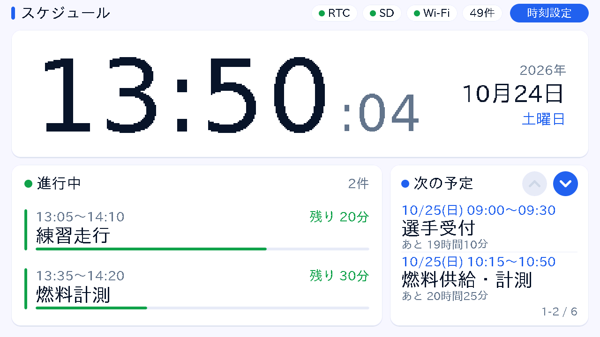
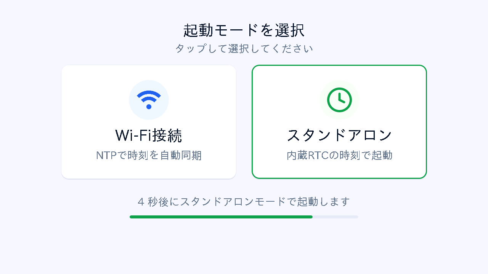
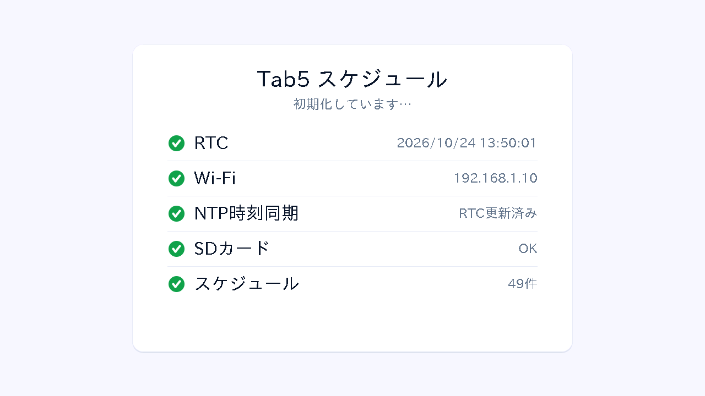
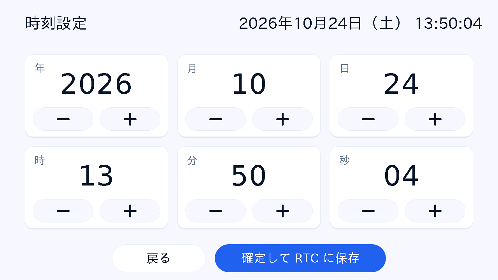

# M5Tab5 スケジューラ表示システム

## 概要

M5Stack Tab5（ESP32-P4）上で、SDカードからCSV形式のスケジュールを読み込み、現在時刻・進行中・今後の予定を大画面に表示するシステムです。  
ネットワーク不要のスタンドアロンモードで動作でき、タッチパネルから直接時刻設定が可能です。Wi-Fi接続時はNTPサーバと自動時刻同期し、RTC（RX8130CE）に書き込むことで電源断後も正確な時刻を保持します。



---

## 特徴

- SDカードのCSVファイルでスケジュールを管理
- **起動時モード選択**（タッチ操作）
  - **Wi-Fiモード**: WiFiManager によるキャプティブポータル経由のWi-Fi設定・NTP同期
  - **スタンドアロンモード**: ネットワーク不要、RTC時刻でそのまま起動（5秒タイムアウトで自動選択）
- **タッチパネル操作**
  - 起動モード選択ボタン
  - 時刻設定画面（年/月/日/時/分/秒を +/− ボタンで入力し RTC に保存、長押しで連続増減、「戻る」で保存せずに終了）
  - 次の予定リストの ▲▼ スクロール
- **NTPサーバ（ntp.nict.jp）** との自動時刻同期（JST対応）
- Tab5内蔵のRTC（RX8130CE）で電源断後も時刻保持（Wire1/I2C1 を使用）
- 視認性重視のライトテーマ・カード型UI（現在時刻 → 進行中 → 次の予定 の優先順で大きく表示）
- 進行中の予定は最大3件（残り時間・進捗バー付き）、次の予定は2件ずつ表示（スクロールで全件確認可能）
- シリアル経由でのRTC時刻手動設定にも対応
- **ちらつきのないスムーズな画面更新**
  - 描画はすべて全画面スプライト（オフスクリーンバッファ）に行い、変更した矩形だけをクリップして1回で転送
  - 毎秒の更新は秒表示の小領域のみ、時計と予定欄は分が変わったときのみ更新
  - ディスプレイへの直接描画は行わない（Tab5 は PSRAM 上の単一フレームバッファを DSI が常時読み出すため、細切れの直接描画は帯域を圧迫し画面全体が水色に化ける原因になる）

---

## 必要なハードウェア

- M5Stack Tab5
- microSDカード（schedule.csv 配置用）

---

## 必要なライブラリ（PlatformIO 自動インストール）

| ライブラリ | バージョン | 用途 |
| --------- | --------- | --- |
| [M5Unified](https://github.com/m5stack/M5Unified) | >= 0.2.17 | 画面・タッチ・ハードウェア制御 |
| [M5GFX](https://github.com/m5stack/M5GFX) | >= 0.2.22 | グラフィックス・スプライト描画 |
| [WiFiManager](https://github.com/tzapu/WiFiManager) | ^2.0.17 | Wi-Fi設定ポータル |
| [CSV_Parser](https://github.com/michalmonday/CSV-Parser-for-Arduino/) | ^1.4.1 | CSVファイル解析 |
| [ArtronShop_RX8130CE](https://github.com/ArtronShop/ArtronShop_RX8130CE) | ^1.0.0 | RTC制御 |

> **注意**: M5Tab5 のタッチスクリーン（GT911）には M5Unified >= 0.2.17 / M5GFX >= 0.2.22 が必要です。

---

## セットアップ手順

1. **SDカードにスケジュールCSVを配置**

　　`microsd/schedule.csv` のスケジュールは[Honda エコ マイレッジチャレンジ](https://global.honda/jp/emc/)の全国大会・鈴鹿大会のCNグループⅣを対象とする。

   ファイル名：`/schedule.csv`（SDカードのルート直下）

   ```csv
   start,stop,action
   2025/6/8 9:00,2025/6/8 10:00,会議
   2025/6/8 14:00,2025/6/8 15:00,プレゼン
   ```

2. **ビルド・アップロード**

3. **起動時のモード選択（タッチ操作）**

   起動後に選択画面が表示されます（5秒でスタンドアロンへ自動移行）：

   | ボタン | 動作 |
   | ----- | ---- |
   | **Wi-Fi接続** | WiFiManager でWi-Fi設定→NTP同期→RTC更新 |
   | **スタンドアロン** | Wi-Fiをスキップ、RTC時刻でそのまま起動 |

4. **初回スタンドアロン起動時の時刻設定**

   RTC に有効な時刻（2020年以降）が未設定の場合、タッチ操作で時刻設定画面が自動表示されます。  
   年/月/日/時/分/秒を **−/＋** ボタンで調整し（長押しで連続増減）、**「確定して RTC に保存」** をタップ。

5. **Wi-Fi接続モードの初回Wi-Fi設定**

   - スマートフォン等で SSID **`M5Tab5_Setup`** に接続
   - ブラウザが自動起動するキャプティブポータルからWi-Fi認証情報を入力
   - 設定は不揮発メモリに保存され、次回以降は自動接続

---

## 動作フロー

```txt
起動
 ↓
RTC初期化（Wire1/I2C1: SDA=31, SCL=32）
 ↓
起動モード選択画面（5秒タイムアウト → スタンドアロン）
  ├─ Wi-Fi接続 → WiFiManager → NTP同期 → RTC更新
  └─ スタンドアロン → （RTC未設定なら）タッチ時刻設定画面
 ↓
SDカード初期化 → スケジュール読み込み
 ↓
メインループ（100ms周期で時刻取得・秒が変わったら更新、タッチ入力ポーリング）
```

---

## 画面表示

| 領域 | 内容 |
| --- | ---- |
| ヘッダー左 | タイトル |
| ヘッダー右 | RTC / SD / Wi-Fi / スケジュール件数のステータス、「時刻設定」ボタン |
| 上段（全幅） | 現在時刻（特大の HH:MM＋秒）と年・月日・曜日 |
| 下段左 | 進行中の予定（最大3件、残り時間・進捗バー付き） |
| 下段右 | 次の予定（2件ずつ、▲▼でスクロール、今日以外は日付付き） |

| 起動モード選択 | 起動完了 |
| --- | --- |
|  |  |
| **メイン画面** | **時刻設定** |
|  |  |

> 画像は `src/main.cpp` を PC 上で動かして描画した擬似スクリーンショットです（2026/10/24 13:50 時点、`microsd/schedule.csv` 使用）。

---

## スクリーンショットの作成

### PC で擬似的に作成（実機不要）

`src/main.cpp` を M5GFX の PC 向けビルド（SDL 版）でそのまま動かし、`setup()` → `loop()` を仮想時刻で進めながら各画面を `createPng()` で保存します。Wi-Fi・SD・RTC・タッチは `tools/sim/stubs/` のスタブで置き換えています。

```sh
brew install sdl2                 # 初回のみ（macOS）
./tools/sim/build.sh              # docs/screenshot_*.png を出力
./tools/sim/build.sh "2026/10/25 12:40:00"   # 表示する時刻を指定
```

M5GFX は PlatformIO が取得した `.pio/libdeps` のものを使うため、先に一度 `pio run` でビルドしておいてください。

### 実機の画面を保存

シリアルで `screenshot` を送ると、表示中の画面を PNG にして返します（M5GFX の `createPng()`）。

```sh
~/.platformio/penv/bin/python tools/screenshot.py /dev/cu.usbmodem101 docs/screenshot_main.png
# 再起動して起動モード選択画面を撮る
~/.platformio/penv/bin/python tools/screenshot.py /dev/cu.usbmodem101 docs/screenshot_mode.png \
    --reboot --wait-for "シリアルで時刻設定" --delay 1.0
```

---

## タッチ操作一覧

| タッチ位置 | 動作 |
| --------- | ---- |
| モード選択画面 — 左カード「Wi-Fi接続」 | Wi-Fiモードで起動 |
| モード選択画面 — 右カード「スタンドアロン」 | スタンドアロンで起動 |
| メイン画面 右上「時刻設定」 | 時刻設定画面を開く |
| メイン画面「次の予定」の「▲」 | 次の予定を上にスクロール |
| メイン画面「次の予定」の「▼」 | 次の予定を下にスクロール |
| 時刻設定画面 −/＋ ボタン | 各フィールドを増減（長押しで連続） |
| 時刻設定画面「確定して RTC に保存」 | 入力値をRTCに書き込んで終了 |
| 時刻設定画面「戻る」 | 保存せずに元の画面へ戻る |

---

## トラブルシューティング

| 症状 | 確認事項 |
| --- | ------- |
| RTC:NG 表示 | I2Cピン（Wire1: SDA=31, SCL=32）・モジュール接続を確認 |
| SDカード:NG 表示 | SDカードの挿入・FAT32フォーマット・接触を確認 |
| スケジュールが表示されない | `/schedule.csv` の存在とCSV形式を確認 |
| Wi-Fi:NG 表示 | 再起動して `M5Tab5_Setup` APに接続し再設定 |
| NTP同期失敗 | Wi-Fi接続後もインターネット疎通を確認 |
| タッチが反応しない | M5Unified >= 0.2.17 / M5GFX >= 0.2.22 が必要（platformio.iniを確認） |
| 画面が一瞬水色になる / ログに `underrun happens` | PSRAM 200MHz が必要。pioarduino 55.03.39 以降の `esp32-p4-evboard`（PSRAM 200MHz のビルド済みライブラリ）を使う。`custom_sdkconfig` を指定するとライブラリ再ビルドが走りビルドに失敗するため指定しない |

---

## ライセンス

MIT License
